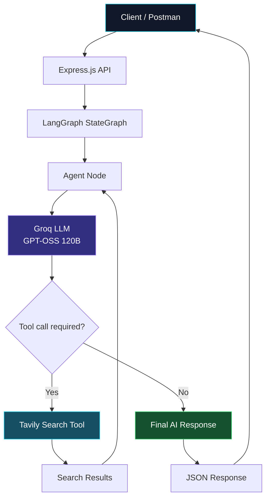
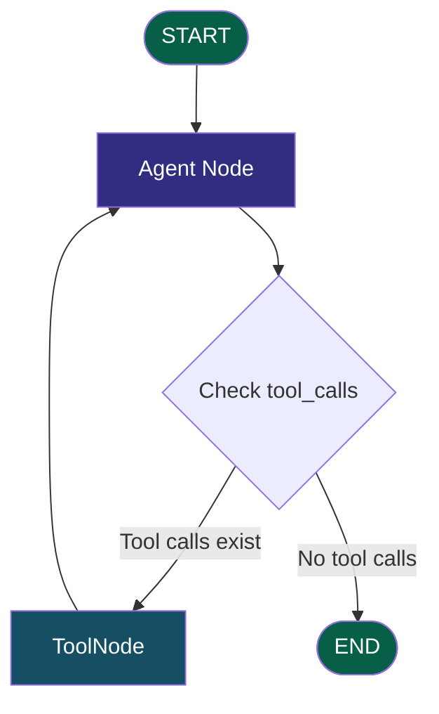

# LLM-Langchain-LangGraph-WebSearchTool-
Advanced Backend

# 🤖 JARVIS — AI Agent with LangGraph & Web Search

An AI-powered assistant built with **LangChain, LangGraph, Groq, and Tavily Search**. JARVIS can answer user questions, search the web for relevant information, and use search results to generate contextual responses.

## ✨ Features

- 🧠 **LLM-powered responses** using Groq and `openai/gpt-oss-120b`
- 🔄 **Stateful workflows** using LangGraph
- 🌐 **Web search integration** using Tavily Search
- 🛠️ **Tool calling** through LangChain's tool integration
- 🔀 **Conditional routing** to decide whether to execute a tool or finish
- 💬 **Conversation message management** using `MessagesAnnotation`
- 🚀 **REST API** built with Express.js

## 🏗️ Architecture



## 🔄 LangGraph Workflow

LangGraph manages the agent's execution using a graph of nodes and edges.



### Workflow explanation

1. **User input:** The client sends a question to the Express API.
2. **Agent execution:** LangGraph invokes the agent node, which calls the Groq-hosted language model.
3. **Conditional routing:** The graph checks the latest AI message for tool calls.
4. **Tool execution:** If the model requests a search, `ToolNode` executes Tavily.
5. **Context update:** Search results are added to the message history.
6. **Agent continuation:** The LLM processes the search results and generates a response.
7. **Final output:** The graph finishes and Express returns the response as JSON.

## 🧰 Tech Stack

| Technology | Purpose |
|---|---|
| Node.js | JavaScript runtime |
| Express.js | REST API server |
| LangChain | LLM and tool integration |
| LangGraph | Agent workflow and conditional routing |
| Groq | LLM inference provider |
| GPT-OSS 120B | Language model |
| Tavily Search | Web search tool |
| dotenv | Environment variable management |
| Postman | API testing |

## 📂 Project Structure

```text
jarvis-ai-agent/
├── index.js          # Express server and LangGraph workflow
├── .env              # API keys (not committed)
├── .gitignore
├── package.json
└── README.md
```

*Adjust the structure above if your repository uses different filenames or folders.*

## ⚙️ Installation

### 1. Clone the repository

```bash
git clone https://github.com/YOUR_USERNAME/YOUR_REPOSITORY.git
cd YOUR_REPOSITORY
```

### 2. Install dependencies

```bash
npm install
```

Ensure the required packages are installed:

```bash
npm install express dotenv @langchain/groq @langchain/langgraph @langchain/langgraph-prebuilt @langchain/tavily
```

If your project uses the Google GenAI SDK as well, install its dependencies separately.

### 3. Configure environment variables

Create a `.env` file in the project root:

```env
GROQ_API_KEY=your_groq_api_key
TAVILY_API_KEY=your_tavily_api_key
```

Keep your API keys private. Never commit `.env` to GitHub.

### 4. Start the server

```bash
node index.js
```

If you have configured a development script with Nodemon, you can use:

```bash
npm run dev
```

Expected terminal output:

```text
Server Started
```

## 🔑 API Documentation

### Health Check

**Endpoint:** `GET /`

Example response:

```json
{
  "message": "Hello from level 4"
}
```

### Ask JARVIS

**Endpoint:** `POST /ai`

**Content-Type:** `application/json`

Request body:

```json
{
  "input": "What is JavaScript?"
}
```

Example response:

```json
{
  "ai": "JavaScript is a high-level programming language used to build interactive web applications..."
}
```

The actual response depends on the model and the information retrieved.

### Example web-search request

```json
{
  "input": "Search the web for the latest Node.js LTS version."
}
```

When the model decides that web search is necessary, it can call Tavily through the LangGraph tool node and use the returned information to formulate an answer.

## 🧠 How Tool Calling Works

The LLM is connected to the Tavily tool using LangChain's tool-binding functionality.

```javascript
const tools = [tool];
const toolNode = new ToolNode(tools);

const llm = new ChatGroq({
  model: "openai/gpt-oss-120b",
  temperature: 0.7,
  maxTokens: 200,
  maxRetries: 2
}).bindTools(tools);
```

The agent's conditional-routing function checks whether the latest AI message contains tool calls.

```javascript
const shouldContinue = (state) => {
  const lastMessage =
    state.messages[state.messages.length - 1];

  if (lastMessage.tool_calls?.length > 0) {
    return "tools";
  }

  return "__end__";
};
```

The graph routes tool requests to `ToolNode` and then returns to the agent. If no tool call is requested, execution ends.

## 🛡️ Security Notes

- Store API keys in environment variables.
- Add `.env` to `.gitignore`.
- Validate incoming request bodies.
- Handle API failures and rate limits gracefully.
- Avoid exposing stack traces or secrets in API responses.

## 🚧 Current Limitations

- Web search depends on Tavily's availability, configuration, and search results.
- The model may occasionally produce inaccurate or incomplete answers.
- Output length is constrained by the configured token limit.
- This implementation does not automatically provide guaranteed live weather, date, or other real-time data unless suitable information is supplied or retrieved.

## 🎯 Learning Objectives

This project demonstrates practical implementation of:

- LLM integration with LangChain
- Agent workflows with LangGraph
- Conditional edges and graph routing
- Tool calling and web search
- Message-state management
- Express API development
- Debugging LLM and tool responses

## 🚀 Future Improvements

- Add streaming responses.
- Implement conversation memory across requests.
- Improve error handling and request validation.
- Add structured logging.
- Support multiple tools and more advanced agent workflows.

## 📄 License

Choose a license appropriate for your project, such as the MIT License, before publishing it for reuse.

---

**Built to explore AI agents, tool calling, and graph-based LLM workflows.** 🤖
