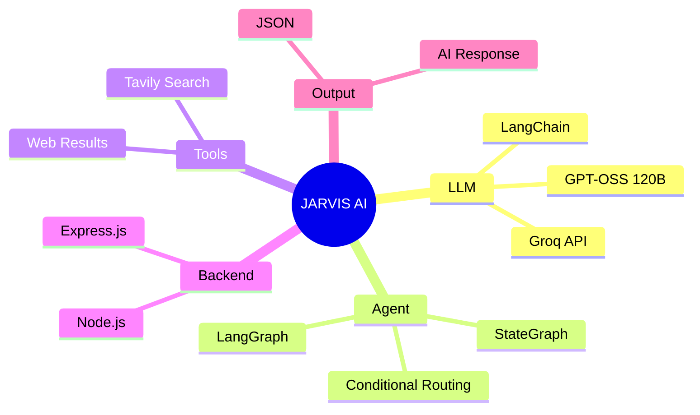
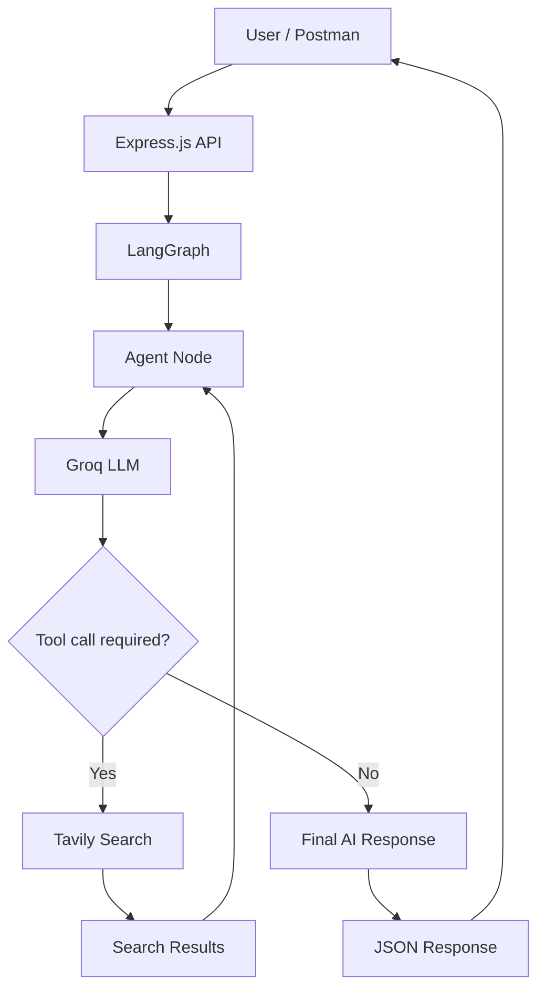
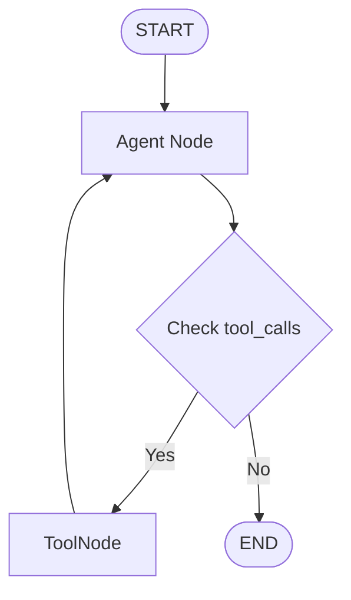

# 🤖 JARVIS — AI Agent

An AI assistant built with **LangChain, LangGraph, Groq, and Tavily Search**. JARVIS answers questions, searches the web when needed, and uses retrieved results to generate responses.

## 🧠 Mind Map



## 🏗️ Architecture



## 🔄 LangGraph Workflow



The agent uses conditional routing to decide whether to execute Tavily Search or return a final answer.

## 🛠️ Tech Stack

- **Node.js & Express.js** — Backend API
- **LangChain** — LLM and tool integration
- **LangGraph** — Agent workflow and state management
- **Groq** — LLM inference
- **GPT-OSS 120B** — Language model
- **Tavily Search** — Web search tool
- **Postman** — API testing

## ⚙️ Installation

### 1. Clone the repository

```bash
git clone https://github.com/YOUR_USERNAME/YOUR_REPOSITORY.git
cd YOUR_REPOSITORY
```

### 2. Install dependencies

```bash
npm install
```

Ensure your project has the required packages:

```bash
npm install express dotenv @langchain/groq @langchain/langgraph @langchain/tavily
```

### 3. Configure environment variables

Create a `.env` file:

```env
GROQ_API_KEY=your_groq_api_key
TAVILY_API_KEY=your_tavily_api_key
```

Use the exact environment variable names referenced in your code. Add `.env` to `.gitignore` to protect your API keys.

### 4. Run the server

```bash
node index.js
```

## 📡 API Usage

### Health Check

**GET** `/`

```http
http://localhost:5001/
```

Example response:

```json
{
  "message": "Hello from level 4"
}
```

### Ask JARVIS

**POST** `/ai`

```http
http://localhost:5001/ai
```

Request body:

```json
{
  "input": "What is JavaScript?"
}
```

Example response:

```json
{
  "ai": "JavaScript is a programming language used to build interactive web applications."
}
```

### Web Search Example

```json
{
  "input": "Search the web for the latest Node.js LTS version."
}
```

When the model requests a search, LangGraph routes execution to Tavily and returns the results to the agent for response generation.

## 📂 Project Structure

```text
jarvis-ai-agent/
├── index.js
├── .env
├── .gitignore
├── package.json
└── README.md
```

*Adjust this structure to match your actual repository.*

## 🔐 Security

- Never commit API keys or your `.env` file.
- Validate incoming API requests.
- Handle API errors and rate limits appropriately.

---

**Built with LangChain, LangGraph, Groq, and Tavily.** 🚀
