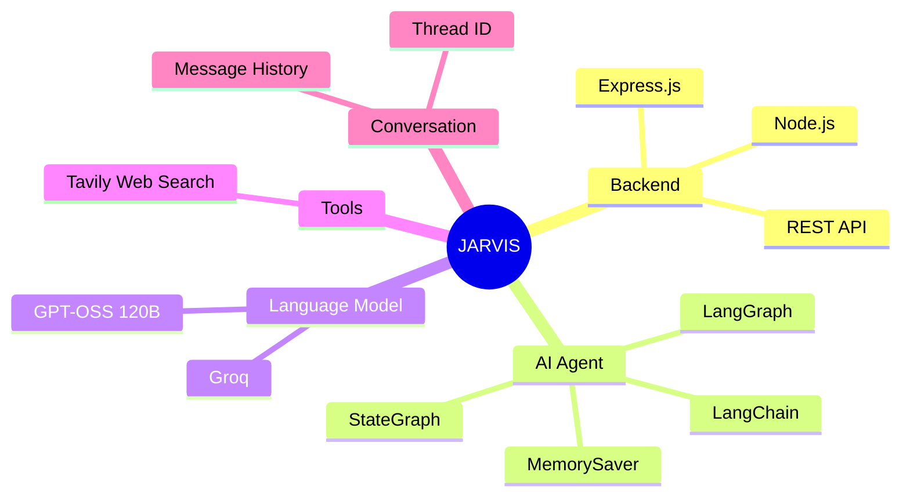
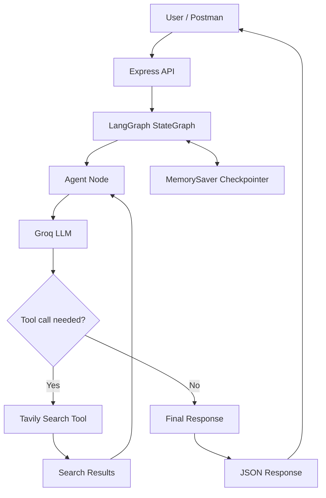

# 🤖 JARVIS — AI Agent with Web Search & Memory

JARVIS is an AI agent built using **Node.js, Express, LangChain, LangGraph, Groq, and Tavily Search**. It answers questions, searches the web when needed, and maintains conversation state using LangGraph's built-in `MemorySaver` checkpointer.

## 🧠 Mind Map



## 🏗️ Architecture



## ✨ Features

- **AI responses:** Uses Groq with the `openai/gpt-oss-120b` model.
- **Web search:** Uses Tavily when the agent requests external information.
- **Agent workflow:** LangGraph routes between the agent and tool node.
- **Conversation memory:** `MemorySaver` stores state per conversation thread while the server remains running.
- **REST API:** Exposes endpoints through Express.

## 🛠️ Tech Stack

| Technology | Purpose |
|---|---|
| Node.js | JavaScript runtime |
| Express.js | API server |
| LangChain | LLM and tool integration |
| LangGraph | Agent workflow and state |
| Groq | LLM inference |
| GPT-OSS 120B | Language model |
| Tavily Search | Web search |
| MemorySaver | In-memory conversation checkpoints |

## ⚙️ Setup

### 1. Clone the repository

```bash
git clone https://github.com/PRINCE-TIWARI07/LLM-Langchain-LangGraph-WebSearchTool-.git
cd LLM-Langchain-LangGraph-WebSearchTool-
```

### 2. Install dependencies

```bash
npm install
```

### 3. Configure environment variables

Create a `.env` file in the project root:

```env
GROQ_API_KEY=your_groq_api_key
TAVILY_API_KEY=your_tavily_api_key
```

Use the exact environment variable names referenced in
