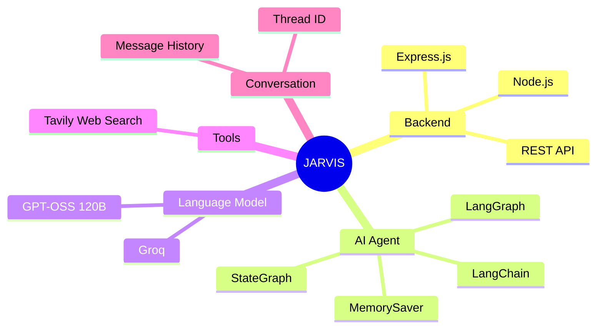
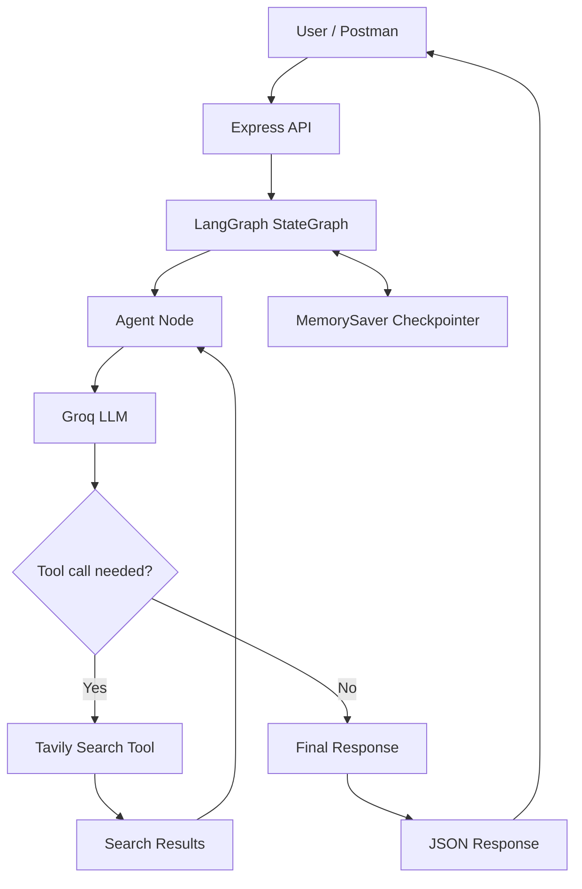
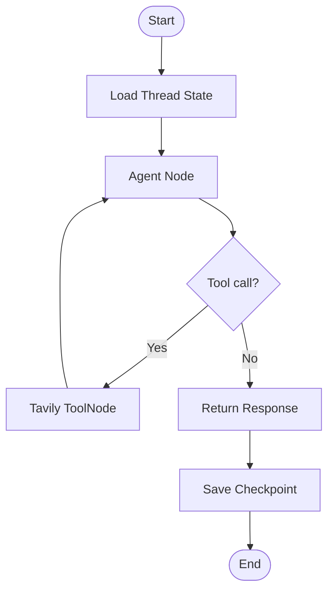

# 🤖 JARVIS — AI Agent with Web Search & Memory

JARVIS is an AI agent built using **Node.js, Express, LangChain, LangGraph, Groq, and Tavily Search**. It answers questions, searches the web when needed, and maintains conversation state using LangGraph's built-in `MemorySaver` checkpointer.

## 🧠 Mind Map



## 🏗️ Architecture



## ✨ Features

- **AI responses:** Uses Groq with the `openai/gpt-oss-120b` model.
- **Web search:** Uses Tavily when the agent requests external information.
- **Agent workflow:** LangGraph routes between the agent and tool node.
- **Conversation memory:** `MemorySaver` stores state per conversation thread while the server remains running.
- **REST API:** Exposes endpoints through Express.

## 🛠️ Tech Stack

| Technology | Purpose |
|---|---|
| Node.js | JavaScript runtime |
| Express.js | API server |
| LangChain | LLM and tool integration |
| LangGraph | Agent workflow and state |
| Groq | LLM inference |
| GPT-OSS 120B | Language model |
| Tavily Search | Web search |
| MemorySaver | In-memory conversation checkpoints |

## ⚙️ Setup

### 1. Clone the repository

```bash
git clone https://github.com/PRINCE-TIWARI07/LLM-Langchain-LangGraph-WebSearchTool-.git
cd LLM-Langchain-LangGraph-WebSearchTool-
```

### 2. Install dependencies

```bash
npm install
```

### 3. Configure environment variables

Create a `.env` file in the project root:

```env
GROQ_API_KEY=your_groq_api_key
TAVILY_API_KEY=your_tavily_api_key
```

Use the exact variable names expected by your installed packages. Never commit real API keys or the `.env` file.

### 4. Start the server

```bash
npm run dev
```

The server runs on port `5001`.

## 📡 API Endpoints

### Health check

**GET** `http://localhost:5001/`

Example response:

```json
{
  "message": "Hello from level 4"
}
```

### Ask JARVIS

**POST** `http://localhost:5001/ai`

Example request:

```json
{
  "input": "What is LangGraph?",
  "threadId": "prince-1"
}
```

Example response:

```json
{
  "ai": "LangGraph is a framework for building stateful applications and agent workflows."
}
```

### Continue a conversation

Send another request with the same `threadId`:

```json
{
  "input": "Can you explain it with an example?",
  "threadId": "prince-1"
}
```

Using the same thread ID lets LangGraph load that conversation's saved state. Use a different ID for an independent conversation.

## 🔄 Workflow



## 📂 Project Structure

```text
.
├── index.js
├── package.json
├── package-lock.json
├── README.md
└── .gitignore
```

## ⚠️ Limitations

- `MemorySaver` stores conversation checkpoints in server memory. Restarting the server clears them.
- Use a persistent checkpointer if conversations must survive server restarts.
- Keep API keys private and exclude `.env` and `node_modules/` from Git.

---

Built with LangChain, LangGraph, Groq, and Tavily Search. 🚀
